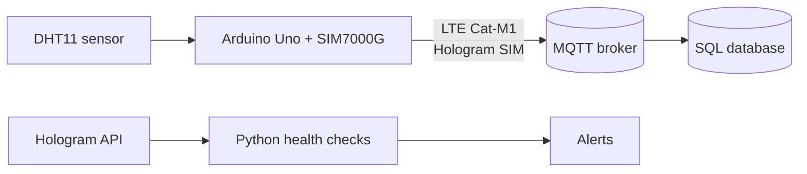

# Cellular Weather Node (Arduino Uno + Hologram SIM)

A small IoT weather station built to work through the full life of a cellular IoT deployment: device bring-up, data transport over MQTT, connectivity monitoring, and troubleshooting.

The end goal is an Arduino Uno that reports temperature, humidity, and its own connection health over LTE Cat-M1 using a Hologram SIM, with Python tooling that watches device health through the Hologram API. It's being built in stages; the current stage uses a laptop as the network link while the cellular shield is on the way.

<p align="center">
  
  <br>
  <em>Stage 1: DHT11 plugged straight into the Uno's GND, 13 and 12 pins. The orange "L" LED is lit because pin 13 powers the sensor.</em>
</p>

## Status

| Stage | What it covers | Status |
|---|---|---|
| 1. Sensor bring-up | Uno reads a DHT11 and emits one JSON line per reading over USB serial | ✅ Done |
| 2. Serial-to-MQTT bridge | Python bridge publishes readings to MQTT with online/offline status and fault handling | ✅ Done |
| 3. Cellular | Botletics SIM7000G shield + Hologram SIM; Uno publishes over Cat-M1 directly, with signal and network diagnostics | ⏳ Hardware ordered |
| 4. Storage | Readings stored in a SQL database for querying and history | Planned |
| 5. Monitoring | Python checks against the Hologram REST API (device status, last session, data usage) with alerting | Planned |

## Architecture

**Today**


**Planned**



The bridge is a deliberate stand-in for the cellular link: the Uno's output format stays the same, so when the shield arrives only the transport changes.

## Hardware

- ELEGOO Uno R3 (Arduino Uno compatible)
- DHT11 temperature/humidity module (3-pin, from the ELEGOO 37-in-1 sensor kit; has a built-in pull-up resistor)
- Coming in stage 3: Botletics SIM7000G LTE Cat-M1/NB-IoT shield, Hologram SIM, 3.7 V LiPo battery (1000 mAh or more)

### Wiring

The DHT11 module plugs directly into the Uno's top header, no jumper wires needed:

| DHT11 pin | Uno pin | Role |
|---|---|---|
| − (ground) | GND (next to AREF) | Ground |
| + (power) | 13 | Power, driven HIGH by the sketch |
| S (signal) | 12 | Data |

Pin 13 can power the sensor because the DHT11 draws only a few milliamps. The Uno's "L" LED stays lit as a side effect.

## Repository layout

| File | Purpose |
|---|---|
| `uno_weather_serial.ino` | Arduino sketch: reads the DHT11 every 10 s and prints JSON |
| `serial_mqtt_bridge.py` | Reads the Uno's serial output and publishes it to MQTT |
| `requirements.txt` | Python dependencies |

## Setup

### 1. Flash the Uno

1. In the Arduino IDE, install **DHT sensor library** by Adafruit (choose *Install All* to include Adafruit Unified Sensor).
2. Open `uno_weather_serial.ino`, select **Arduino Uno** and the board's port, and upload.
3. Open the Serial Monitor at 9600 baud to confirm readings, then close it before starting the bridge.

### 2. Run the bridge

```bash
python3 -m venv .venv
source .venv/bin/activate
pip install -r requirements.txt

# Find the Uno's port
ls /dev/cu.*

# Print messages locally without publishing
python3 serial_mqtt_bridge.py --dry-run --port /dev/cu.usbmodem1101

# Publish to the public test broker
python3 serial_mqtt_bridge.py --port /dev/cu.usbmodem1101
```

Watch the messages from another terminal:

```bash
mosquitto_sub -h test.mosquitto.org -t 'hologram-mvp/#' -v
```

`test.mosquitto.org` is public, so anyone can read what's published there. Use `--broker` to point at a private broker for anything sensitive.

## Data format

The Uno prints one JSON object per line. The bridge adds `device_id` and `received_at` (UTC) and publishes to a topic based on the message type.

| Topic | When | Example payload |
|---|---|---|
| `hologram-mvp/<device>/reading` | Successful read (retained) | `{"t_c":28.9,"rh":37.0,"uptime_s":20,"reads":3,"read_errors":1,"device_id":"uno-weather-01","received_at":"2026-10-25T06:14:14+00:00"}` |
| `hologram-mvp/<device>/error` | Sensor read failed | `{"error":"dht_read_failed","uptime_s":0,"reads":1,"read_errors":1,...}` |
| `hologram-mvp/<device>/event` | Device boot | `{"event":"boot",...}` |
| `hologram-mvp/<device>/status` | Bridge connects or drops (retained) | `online` / `offline` |

`reads` and `read_errors` are running counters, so a subscriber can compute the sensor's error rate without storing history.

## Reliability features in the bridge

- **Last will and testament:** the broker publishes `offline` to the status topic if the bridge disconnects unexpectedly, so subscribers can tell "no new data" apart from "bridge is down".
- **Reconnects:** MQTT reconnects with backoff (1–30 s) and queues QoS 1 messages while the broker is unreachable; the serial port is reopened automatically if the Uno is unplugged.
- **Silence detection:** logs a warning if the device sends nothing for 35 s (readings arrive every 10 s).
- **Input validation:** partial or unrecognized lines are skipped rather than published.
- **No guessing:** if more than one board is connected, the bridge lists the ports and asks for `--port` instead of picking one.

## Troubleshooting log

Real issues hit during the build, how they were diagnosed, and what changed as a result.

### Bridge connected but received no data

**Symptom:** the bridge opened `/dev/cu.usbserial-1140` and then logged `no data from device for 36 s`. The Arduino Serial Monitor showed readings normally.

**Diagnosis:** ruled out the usual causes (Serial Monitor holding the port, sketch not running), then listed the serial devices with `ls /dev/cu.*`. There were two: `usbmodem1101` and `usbserial-1140`. A second board (an ESP8266 NodeMCU, whose CP2102 USB chip also appears as `usbserial`) was plugged in, and auto-detection had picked it instead of the Uno.

**Fix:** ran the bridge with `--port /dev/cu.usbmodem1101`. Changed auto-detection to refuse to guess when several boards match and print the candidates instead, so the failure is obvious rather than silent.

### First reading after power-up fails

**Symptom:** each boot logs one `dht_read_failed`, then reads succeed.

**Diagnosis:** the DHT11 needs about a second after power-up before it responds. Since the sketch powers the sensor from pin 13, it starts cold on every boot.

**Fix:** the sketch waits one second after powering the sensor. Occasional first-read failures are expected and visible in the `read_errors` counter rather than hidden.

### Cut-off line when the bridge starts

**Symptom:** the first line received sometimes looks like `{"evs":2,"read_errors":1}`.

**Diagnosis:** opening the serial port resets the Uno, which interrupts whatever line it was printing. The tail of that line can still be valid JSON.

**Fix:** the bridge only publishes messages it recognizes (readings, errors, events) and skips everything else.

### Temperature reads a few degrees high

**Observation:** about 29 °C in a cooler room. The sensor is plugged directly into the Uno, so it picks up heat from the board, and the DHT11 is only accurate to ±2 °C. Moving the sensor a few inches away on jumper wires should bring readings closer to room temperature.

## Roadmap

- [ ] Solder headers onto the SIM7000G shield and power it from a LiPo (the modem's transmit spikes can reach about 2 A, more than USB reliably supplies)
- [ ] Activate the Hologram SIM and attach to Cat-M1, with NB-IoT as a fallback
- [ ] Report signal strength (RSSI), registration status, and radio technology alongside each reading
- [ ] Publish over cellular from the Uno, retiring the laptop bridge
- [ ] Store readings in SQL
- [ ] Python health checks against the Hologram API with offline and data-usage alerts
- [ ] Write a bring-up runbook for provisioning a new device from SIM activation to first message
